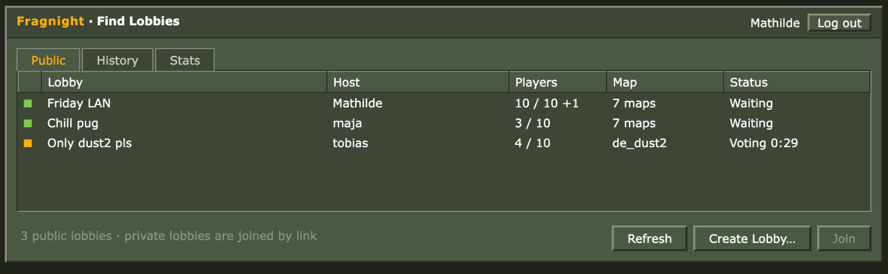
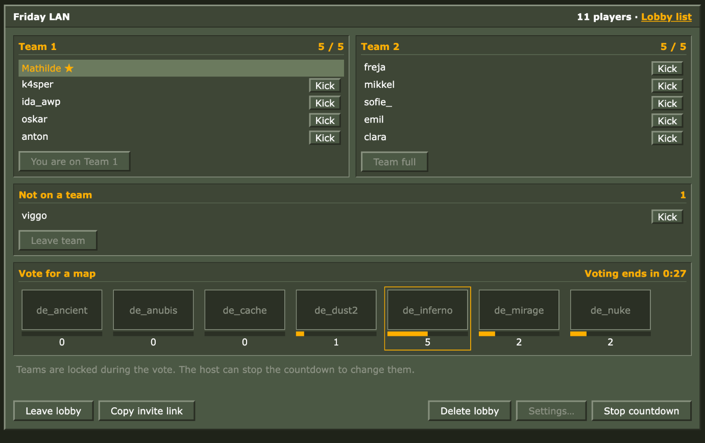
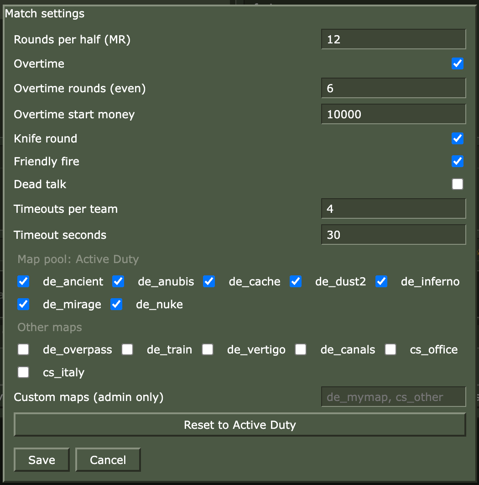
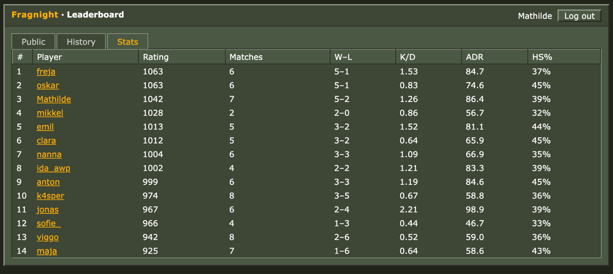
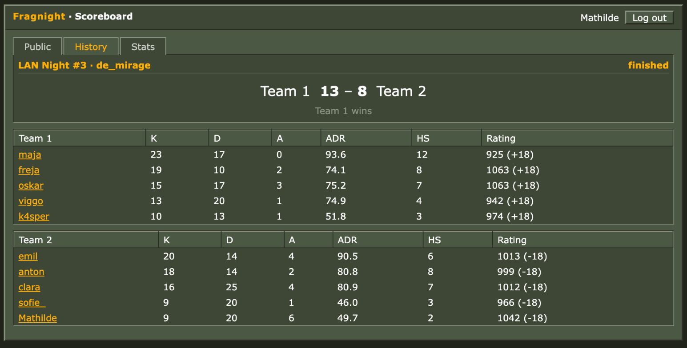

<p align="center"></p>
<h1 align="center">Fragnight</h1>

A self-hosted lobby for Counter-Strike 2 LAN parties. Sign in with Steam, pick teams, vote on a map, and play on a server the app sets up for you. Stats and ELO carry over from night to night. The interface is styled like the old CS 1.6 menus.

> Unofficial: not affiliated with or endorsed by Valve. Counter-Strike, CS2 and Steam are Valve's trademarks. No Valve assets are included; the look is plain CSS.



## Features

- Public and private lobbies, joined from a list or by link
- Self-service 5v5 teams; the host can kick players and swap sides
- 30-second map vote, defaulting to the Active Duty pool
- Matches start automatically on a pool of CS2 servers through [MatchZy](https://github.com/shobhit-pathak/MatchZy), with a queue when all are busy
- Tournament defaults (MR12, overtime, knife round), adjustable by the host within limits
- Leaderboard, ELO, match scoreboards, rematch, and an admin page

## Screenshots

Players and matches below are demo data.









## Status

The app is covered by automated tests, but it **has not been run against a real CS2 server yet**. The container setup, MatchZy commands and event formats follow MatchZy's docs and are unverified. See [`deploy/README.md`](deploy/README.md) ("Not verified yet") before using it for a real match.

## Quick start

Needs Docker; run the CS2 servers on a Linux host.

```
cd deploy
cp .env.example .env    # fill in the secrets
docker compose up -d --build lobby
```

Open the `BASE_URL` you set. Steam login needs internet access from the lobby server. Settings and adding CS2 servers are covered in [`deploy/README.md`](deploy/README.md).

## Development

```
go vet ./... && go test -race ./...
```

## License

[MIT](LICENSE). Third-party licenses: [THIRD_PARTY_NOTICES.md](THIRD_PARTY_NOTICES.md).
